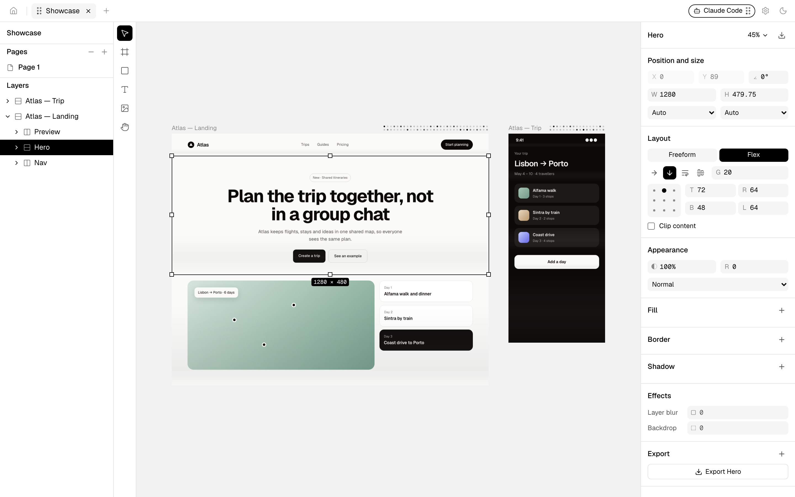
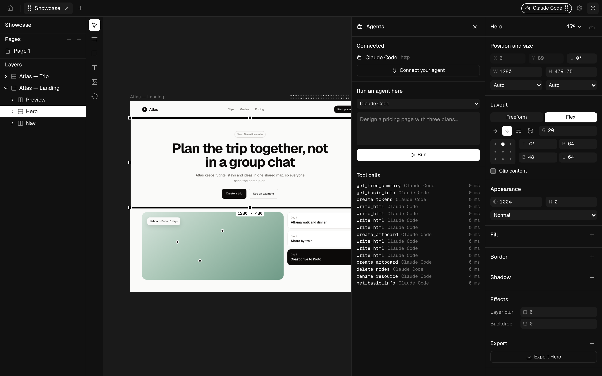

<picture>
  <source media="(prefers-color-scheme: dark)" srcset="web/public/brand/spark-white.svg">
  
</picture>

# Spark

Spark is an opensource design tool for working with AI agents. Designs are real HTML and CSS, so what you draw is what ships. The document core is Rust, files live on your disk as `.spark` files, and any MCP-capable agent (Claude Code, Codex, Cursor, VS Code, OpenCode, Gemini CLI and others) can read and edit the canvas while you watch. The interface is black, white and gray.





The screenshots show [`fixtures/demo/Showcase.spark`](fixtures/demo/Showcase.spark), a made-up design generated by `bun run screenshots`.

## What it does

- **A canvas of real DOM.** Frames, rectangles, text and SVG render as HTML elements with inline CSS: flexbox, fonts, gradients, borders, shadows, blur. Pan, zoom, select, drag, resize with snapping, draw, and type in place.
- **An inspector for CSS you can read**: position and size (fixed, fill, hug), freeform or flex layout, fills, borders, shadows, typography, effects and export presets, plus design tokens in Tailwind v4 namespaces.
- **Code in and out.** Paste HTML and it becomes layers; copy any selection as HTML, JSX with inline styles, or JSX with Tailwind classes.
- **Agents over MCP.** Spark runs an MCP server with tools to read the file, write HTML, change styles, manage pages and tokens, take screenshots and export. You see which agents are connected and where they are working.
- **Images your way.** Agents can place images they have, fill image requests with whatever model they use, or generate through providers you enable with your own keys (OpenAI, Gemini, fal.ai, Replicate, OpenRouter, ComfyUI, Automatic1111), within limits you set.
- **Export** to PNG, JPG, WebP, SVG and PDF from the inspector, MCP or the `spark` CLI.

## Build and run

You need Rust (stable), Bun 1.4+ and Node 22+ (Bun installs and runs the scripts; Vite, Vitest and Playwright run on Node).

```sh
bun install
bun run build                 # web UI and the `spark` binary
./target/debug/spark serve    # prints the URL (with its access token) to open in a browser
```

The desktop app (Tauri v2) wraps the same server and UI:

```sh
bun run --cwd apps/desktop dev     # run
bun run --cwd apps/desktop build   # bundle (Spark.app / installers)
```

For UI work, run `spark serve` and `bun run dev` side by side; Vite proxies the server's routes.

## Connect an agent

From the home screen, choose **Connect your agent**, or use the CLI:

```sh
spark connect claude-code     # also: codex, cursor, vscode, copilot, opencode, gemini, claude-desktop
spark connect codex --dry-run # show the change without writing it
spark disconnect cursor
```

Spark adds a `spark` entry that runs `spark mcp`, a small stdio relay to the running app, and keeps the rest of the config file (comments included) as it was. Then ask your agent to design something in Spark. The **agent panel** (⌘J) can also run an installed agent CLI on the open file and stream its output.

## The `spark` command

| Command | Does |
|---|---|
| `spark serve` | Run the server and web UI headless |
| `spark mcp [--headless]` | The MCP stdio relay agents launch |
| `spark connect <agent>` / `disconnect` | Edit an agent's MCP config |
| `spark export <file> --format png --scale 2x` | Export artboards or `--node` ids: png, jpg, webp, svg, pdf, html, jsx, tailwind; `--combined` PDF; `--tokens theme`; `--json` |
| `spark demo <path> --nodes 2000` | Write a generated demo file |

## Project layout

| Path | What lives there |
|---|---|
| `crates/spark-core` | The document: ids, nodes, styles, ops, undo, `.spark` persistence, HTML import, code and SVG export |
| `crates/spark-server` | axum server: the `/ui` WebSocket, the `/mcp` endpoint, agents, images, export, headless layout |
| `crates/spark-cli` | The `spark` binary |
| `apps/desktop` | Tauri v2 shell: window, menus, deep links, file association |
| `web` | React + TypeScript + Tailwind v4 UI |
| `e2e` | Playwright tests against `spark serve` (Chromium and WebKit) |
| `fixtures` | The generated demo file and the agent config files that tests run against |
| `docs` | [Spec](docs/SPEC.md), [architecture](docs/ARCHITECTURE.md), [decisions](docs/DECISIONS.md), [performance](docs/PERFORMANCE.md), agent guides |

## Contributing

Contributions are welcome. [CONTRIBUTING.md](CONTRIBUTING.md) covers setup, the checks every change passes and how to open a pull request, and [AGENTS.md](AGENTS.md) gives coding agents the same rules.

## License

[MIT](LICENSE). Bundled fonts (Geist, OFL) and icons (Lucide, ISC) keep their own licenses next to them. Spark is an independent project and is not affiliated with any other design tool.
